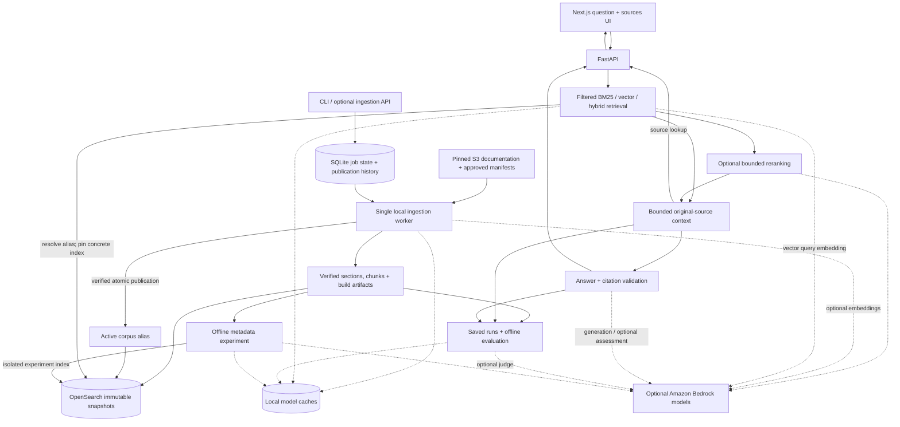

# Aether — AWS S3 Knowledge Engine

Ask questions about Amazon S3 documentation and inspect the original passages behind an answer. Aether combines a Next.js question-and-sources interface, a Python API, and OpenSearch retrieval over a curated, reproducible documentation snapshot.

**Default keyword source search runs locally without AWS credentials or model calls.** Generated answers, vector search, reranking, and model-based evaluation are optional Bedrock integrations. The project is under active development; independently reviewed quality benchmarks and an AWS deployment are still pending.

## What works today

- **Compare live sources:** run two retrieval modes for one question against the same snapshot, retaining each side’s passages, timing, model-call count, and explicit failures.
- **Inspect sources:** keyword search with guide and corpus filters, original passage text, and links to pinned source material and current publisher documentation.
- **Ask with citations:** Bedrock-generated answers, streaming responses, and citation links back to the selected passages. Missing model configuration is reported while preserving retrieved sources.
- **Choose retrieval:** BM25, vector search, or hybrid retrieval with reciprocal rank fusion. Vector and hybrid modes require an embedding-enabled corpus and Bedrock configuration.
- **Optionally rerank:** reorder a bounded candidate window through a separately configured Bedrock ranker, with explicit failure/fallback reports and original-source identity preserved.
- **Try a bounded workflow:** an optional LangGraph flow assesses evidence, can refine retrieval once, and answers or returns insufficient evidence. It has explicit call, retrieval, and time limits.
- **Publish safely:** durable local ingestion jobs, idempotency keys, cancellation, recovery, immutable index snapshots, atomic alias publication, and rollback to retained snapshots.
- **Evaluate reproducibly:** saved rankings and exact answer context, source-span labels, candidate pooling for review, and optional Ragas judging of saved answers.
- **Prepare S3 artifacts:** source-verified local bundles and an explicitly gated transfer to an existing private bucket, with conditional writes and full read-back verification.
- **Prepare metadata experiments:** bounded, cached generation of summaries and topic/intent hints as separate unreviewed artifacts, with original-content fallback on failure.

“S3” describes the documentation domain. The current implementation downloads pinned public text files and stores artifacts locally; it does not inspect your AWS account or ingest arbitrary S3 buckets.

## Architecture



Source hashes and character offsets preserve provenance through extraction and chunking. Each publication builds and verifies a new index before switching the active alias; readers use a concrete snapshot for a consistent request. SQLite and filesystem artifacts support a single-host worker. This is a local development architecture, with OpenSearch authentication disabled and service ports bound to loopback.

## Quickstart: Docker application

Requires Docker with Compose **2.24.4 or later**. Run commands from the repository root. The stack includes OpenSearch, the API, an ingestion worker, and the production frontend; no local Python or Node installation is needed for this path.

```sh
git clone https://github.com/anushacodes/Aether.git
cd Aether

docker compose -f compose.app.yaml build api frontend
docker compose -f compose.app.yaml up -d --no-build --wait --wait-timeout 180

# Download and hash-check the pinned public documentation.
docker compose -f compose.app.yaml exec api s3-rag --config config.toml corpus fetch

# First publication into a fresh stack. The running worker picks up this job.
docker compose -f compose.app.yaml exec api s3-rag --config config.toml jobs submit \
  --key docker-pilot-v1 --base-revision none
```

The submit command prints a `job_id`. Replace `JOB_ID` below with that value and check for `status: ready`:

```sh
docker compose -f compose.app.yaml exec api s3-rag --config config.toml jobs status JOB_ID
docker compose -f compose.app.yaml logs --tail=50 worker
curl --fail http://localhost:18000/health/ready
```

Readiness returns a non-success response until the corpus is published. Open **http://localhost:13000**, enter a question such as “What happens when I delete an object in a versioned bucket?”, and select **Find sources**. The default pilot contains three passages about versioning and deletion. **Compare sources** opens a live two-mode inspection; vector/hybrid need an embedding-enabled snapshot and otherwise show their own explanation. **Ask question** requires the optional model configuration described below.

| Service | Docker application | Native development |
| --- | --- | --- |
| Frontend | http://localhost:13000 | http://localhost:3000 |
| API / interactive API docs | http://localhost:18000/docs | http://localhost:8000/docs |
| OpenSearch | http://localhost:19200 | http://localhost:9200 |

To stop the application while preserving its named data volumes:

```sh
docker compose -f compose.app.yaml down
```

`--base-revision none` is only for the first publication. For later changes, use `jobs catalog` to obtain the current `active_revision`, pass it as `--base-revision`, and choose a new idempotency key. Reusing a key for the same request returns the original job; changing its intent is rejected.

## Native development

Requires Python **3.12**, [uv](https://docs.astral.sh/uv/), Node.js **22.18 or later**, npm, and Docker for OpenSearch. Dependencies are pinned in `uv.lock` and `frontend/package-lock.json`.

```sh
uv sync --locked
npm --prefix frontend ci
make search-up

uv run --locked s3-rag --config config.toml corpus fetch
uv run --locked s3-rag --config config.toml jobs submit \
  --key local-pilot-v1 --base-revision none
uv run --locked s3-rag --config config.toml worker --once

uv run --locked s3-rag --config config.toml search query \
  "What happens when I delete a versioned object?" --mode bm25
```

Start the API and frontend in separate terminals:

```sh
make api
```

```sh
npm --prefix frontend run dev
```

Use `make worker` when you want a continuously running native ingestion worker. Run only one worker for a given state database. The Docker application and native development stack use separate ports and volumes; their corpora are independent.

## Configuration and optional Bedrock calls

[config.toml](config.toml) defines the pilot. [config.core.toml](config.core.toml) selects a separate core corpus, alias, and publication state. CLI commands load TOML when passed `--config`; the API loads root `config.toml` automatically. Exported `RAG_*` environment variables override the corresponding settings.

[.env.example](.env.example) documents supported overrides. The backend does **not** automatically load an `.env` file. Use TOML or export selected variables in the shell that launches the process.

| Setting | Purpose |
| --- | --- |
| `RAG_OPENSEARCH_URL` | Search service URL |
| `RAG_AWS_REGION`, `RAG_AWS_PROFILE` | Bedrock region and optional credential profile |
| `RAG_GENERATION_MODEL_ID` | Explicitly selected Bedrock answer model |
| `RAG_DEVELOPMENT_MODEL_BUDGET_USD` | Required explicit allowance before paid calls; not an AWS billing cap |
| `RAG_EMBEDDING_MODEL_ID`, `RAG_EMBEDDING_DIMENSIONS` | Compatible embedding model and index dimensions; defaults are Titan V2 and 1024 |
| `RAG_EVALUATOR_MODEL_ID` | Separate optional Bedrock judge model |
| `RAG_ENRICHMENT_MODEL_ID` | Separate optional model for offline metadata experiments |
| `RAG_RERANK_MODEL_ARN` | Separate optional ranker; also requires `[reranking] enabled = true` |
| `RAG_ALLOWED_ORIGINS` | JSON array of allowed browser origins |
| `RAG_ADMIN_TOKEN` | Server-configured administrator bearer credential; unset disables ingestion HTTP endpoints |

For generated answers, configure AWS credentials through the normal AWS credential chain, choose an accessible generation model, and set a development allowance. The supplied pilot TOML uses `us-east-1`. Validate configuration without contacting AWS:

```sh
uv run --locked s3-rag --config config.toml config --cloud
```

For a deliberate real-provider capability check, `s3-rag bedrock-check --help` documents the required `--allow-paid`, exact-model price JSON, `--max-cost-usd`, selected original chunk, and new report directory. It makes at most three single-attempt inference requests (embedding, generation, streaming), after one token-count preflight. The cost estimate depends on your supplied current on-demand rates; it is not an account billing cap. Reports preserve attempted stages and unknown charges after failure. Normal tests and CI exercise it only with SDK stubs and never make live provider calls.

After supplying those settings, `ask` generates an answer from BM25 evidence; `--workflow` enables the optional evidence-assessment flow, and `--save-run NEW_DIRECTORY` captures the request, result, and exact context for evaluation. Ingestion with `--with-embeddings` builds vector coverage; vector and hybrid queries can then embed the question through Bedrock. These operations can incur provider charges. Text-only ingestion and BM25 source lookup with reranking disabled do not call a model.

The default application Compose file intentionally passes no AWS credentials or model settings into its services. Use native development for model experiments, or explicitly extend the service configuration. Never place credentials or `RAG_ADMIN_TOKEN` in a `NEXT_PUBLIC_*` variable.

The frontend uses `NEXT_PUBLIC_RAG_API_URL` from [frontend/.env.example](frontend/.env.example). For native development, an optional `frontend/.env.local` can override the default `http://localhost:8000`. The container frontend embeds its browser API URL at **build time**: changing `RAG_API_PORT` or `RAG_BROWSER_API_URL` requires rebuilding the frontend. Use a URL reachable by the browser.

## Corpus and source provenance

The [source manifest](data/manifests/sources.json) pins two public text files—the S3 User Guide and API Reference—to revision `af421087e43e33d41051a80356e285fa4c199b8a` of [the source snapshot repository](https://github.com/PranavMishra17/Metadata-Enrichment-with-LLMs-for-RAGs-Internal-Knowledge-Retrieval/tree/af421087e43e33d41051a80356e285fa4c199b8a/input_files). Downloads are verified against recorded SHA-256 hashes. These are historical snapshots, rather than a live mirror of AWS documentation.

| Corpus | Manifest | Default chunking | Publication alias |
| --- | --- | --- | --- |
| Pilot: 3 selected sections about versioning and deletion | [pilot.json](data/manifests/pilot.json) | Fixed chunks | `s3-rag-active` |
| Core: 40 selected sections covering common S3 operations | [core.json](data/manifests/core.json) | Heading-aware chunks | `s3-rag-core` |

The core selections cover topics including uploads and multipart uploads, downloads and ranges, checksums, access controls, versioning, deletion, and lifecycle. They do not constitute the complete S3 documentation or current guidance for every S3 feature.

To publish the core corpus into the native OpenSearch stack for the first time:

```sh
uv run --locked s3-rag --config config.core.toml corpus fetch
uv run --locked s3-rag --config config.core.toml jobs submit \
  --catalog-id core --key core-initial-v1 --base-revision none
uv run --locked s3-rag --config config.core.toml worker --once
uv run --locked s3-rag --config config.core.toml search query \
  "How does multipart upload work?" --corpus-id s3-core-v1 --mode bm25
```

This leaves the pilot configuration intact. Use the coherent core configuration for both publication and reads: changing `RAG_SEARCH_INDEX` alone does not change the publication alias or job database. The default API and frontend remain on the pilot.

To prepare a verified local artifact bundle for a later user-run S3 transfer:

```sh
uv run --locked s3-rag --config config.core.toml artifacts prepare \
  --subset data/manifests/core.json --output reports/artifacts/core-v1
```

Use a new destination. This records pinned raw inputs, normalized sections/chunks and a text-only build definition without AWS calls. `artifacts upload` separately requires an existing private bucket, expected owner and explicit `--allow-write`; it records read-back verification receipts and does not provision resources.

## API and operations

Example source lookup against the Docker application:

```sh
curl --fail http://localhost:18000/retrieval \
  -H 'Content-Type: application/json' \
  -d '{"query":"What happens when I delete a versioned object?","mode":"bm25"}'
```

| Route | Behavior |
| --- | --- |
| `GET /health/live` | Process liveness |
| `GET /health/ready` | Search service and configured corpus readiness |
| `POST /retrieval` | Source passages without answer generation |
| `POST /retrieval/compare` | Two live retrieval modes with one pinned snapshot and per-mode outcomes |
| `POST /search` | Answer with citations |
| `POST /search/stream` | Answer stream using server-sent events over POST |
| `/ingestion`, `/ingestion/catalog`, `/ingestion/{job_id}` | Token-protected job submission and inspection; cancel/replay routes are also available |

Inspect `AnswerResult.status` as well as HTTP status. Complete-answer citation rejection preserves a `failed` result and known usage for inspection; the CLI exits nonzero and can save that failed record. Streaming citation rejection ends with an `error` event and no validated `done`.

The `/docs` page describes request and response schemas. Requests can restrict guides and corpus identity; generated answers use bounded original passages. Citation validation checks that cited identifiers belong to the supplied evidence. It does not prove that every claim is supported.

API application logs are JSON events correlated by the server-generated `X-Request-ID`. They record timing/outcome, configuration/source fingerprints, known usage and pinned snapshots while omitting questions, passages, credentials and raw provider errors. Stream/comparison worker-exit events are separate from HTTP completion; unknown cost remains unknown. The supplied native/container commands disable raw URL access logging.

Use `s3-rag --help` and command-specific `--help` for the CLI surface. Useful operations include `jobs catalog`, `jobs status`, `jobs cancel`, `jobs replay`, and `index snapshots`. Rollback requires a retained snapshot ID and the expected current concrete index as `--base-revision`; stale publication requests are rejected. Retained snapshots are local recovery material, not an independent backup.

### Local administrator screen

Open `/admin` from **Manage corpus**. Configure a long random `RAG_ADMIN_TOKEN` in the API environment before starting it (Compose also passes this variable to the API), then enter that credential manually on the screen. It is held only in page memory and cleared on lock, reload, or navigation. Never place it in a `NEXT_PUBLIC_*` variable. Every administration request is authenticated by the API; an unlocked browser alone grants no access. This is shared local administrator access, not a hosted multi-user identity system.

Choose a server-approved replacement manifest to queue a versioned rebuild/update; embeddings are off by default and can incur model charges if explicitly enabled. Included sections can be removed through an inline review naming the exact sections and base revision. Recent jobs show durable outcomes, attempt failures, replay, and cancellation. Start the worker and use **Refresh corpus and jobs** after it runs to see publication changes. A published historical job may no longer be the active snapshot.

If submission loses its response, **Retry same submission** reuses the captured request and idempotency key. New mutations stay paused until its outcome is resolved. Locking/reloading clears that in-memory recovery state; inspect recent durable jobs after reconnecting before submitting replacement work.

## Evaluation

Quality labels are kept separate from ingestion evidence. The checked-in [pilot](data/eval/pilot.json) and [core development](data/eval/core-development.json) datasets are **drafts**. They need independent review before their scores can support quality claims; there is no reviewed held-out benchmark yet.

Inspect draft labels without invoking a model:

```sh
uv run --locked s3-rag eval validate \
  --dataset data/eval/core-development.json --allow-drafts
```

List the versioned B0–B5 retrieval treatments without opening services:

```sh
uv run --locked s3-rag eval experiments
```

B0 is BM25, B1 vector, B2 hybrid, B3 hybrid with metadata-prefixed document vectors, B4 hybrid with reranking, and B5 both additions. All use the same supplied base settings; presets keep inferred-field BM25 boost at zero and use strict ranker failures. B3/B5 require `--enriched-index` pointing to a successful matching `index.json` and its retained metadata inputs. Index preflight requires exact original records, write blocking, compatible model inputs and complete vector coverage where needed, before model setup.

For the published native core corpus, prepare matching local inputs and capture a B0 draft run:

```sh
uv run --locked s3-rag --config config.core.toml corpus extract --subset data/manifests/core.json --output data/processed/core-sections.jsonl
uv run --locked s3-rag --config config.core.toml corpus chunk --subset data/manifests/core.json --output data/processed/core-chunks.jsonl
uv run --locked s3-rag --config config.core.toml eval retrieval \
  --experiment B0 --dataset data/eval/core-development.json \
  --sections data/processed/core-sections.jsonl --chunks data/processed/core-chunks.jsonl \
  --allow-drafts --output reports/runs/core-B0-v1
```

Use a new output directory. `experiment.json` retains declared treatment/configuration identity before per-question work. Current core vectors, reviewed labels and real provider comparisons remain prerequisites for the other treatments; presets do not create them automatically or select a release winner. Existing manual `--mode` selection remains available.

The [120-question candidate bank](data/eval/core-candidates-v2.json) preserves the original 20 development drafts and adds 100 unassigned candidates. All remain pending independent review; unassigned candidates are excluded from evaluation runs. Existing commands below keep using the original dataset.

Once references and semantic groups are independently reviewed and splits assigned, `eval freeze` preserves the exact labels, review record, and pinned source evidence in a new archive. `eval verify-freeze` checks that archive offline. The current draft bank is refused; neither command assigns splits or certifies label quality.

The evaluation workflow supports:

1. **Retrieval capture:** `eval retrieval` records rankings, the selected context, configuration identity, and a pinned index. Supply the matching extracted sections and chunks. `--allow-drafts` permits development inspection without certifying label quality.
2. **Evidence review:** `eval pool` combines candidates from compatible saved runs for human review. Repeated retrieval is not treated as a relevance vote.
3. **Saved-answer preparation:** `eval prepare-answers` validates saved answer artifacts against dataset questions and original evidence without model calls.
4. **Optional judging:** `eval judge` runs Ragas faithfulness, context precision with reference, context recall, and factual correctness against reviewed samples using an explicitly configured Bedrock judge.

Compare two or more saved retrieval runs without contacting OpenSearch or Bedrock:

```sh
uv run --locked s3-rag eval compare \
  --dataset data/eval/core-development.json \
  --run reports/runs/core-keyword-context-v2-final \
  --run reports/runs/core-fixed-window-draft-v1 \
  --allow-drafts --output reports/runs/core-chunk-comparison-v1
```

Supply your own completed run directories and a new output directory. The JSON and Markdown reports align every question, retain failures/missing results, and compare scores only on questions scored in every run. Draft labels keep quality scores unavailable. Latency samples retain their denominators/cache conditions; unknown model cost stays unknown. These reports do not select a release configuration.

Install the optional evaluation dependencies and exercise the judge contracts without provider calls:

```sh
uv sync --locked --group eval
make ragas-check
```

The judge runs serially with sample, call, output, and time limits plus a persistent cache. Results preserve errors, undefined scores, and inapplicable cases. The offline check uses synthetic fixtures and SDK stubs; passing it establishes integration behavior, not S3 answer quality. Real provider quality, latency, and cost measurements remain pending.

## Metadata experiments

The optional `enrich` command prepares short summaries, constrained topic/intent labels, related concepts, and example phrasings from explicit source chunks. It requires its own model selection, region, and development allowance. It can incur Bedrock charges and is never invoked by ordinary search or ingestion.

After configuring those settings, prepare the pilot chunks and a new experiment directory:

```sh
uv run --locked s3-rag --config config.toml corpus chunk
uv run --locked s3-rag --config config.toml enrich \
  --output reports/runs/pilot-metadata-v1
```

The default limit is ten chunks and twenty calls, including at most one repair per malformed response. Larger inputs are rejected rather than silently truncated; use repeated `--chunk-id` arguments to select an explicit subset. Valid metadata is cached by exact input, model, schema, and prompt settings. Failures preserve the complete original passage and return a nonzero CLI exit status.

Artifacts include unchanged source records, per-chunk outcomes, proposed embedding inputs, hashes, and known token usage. Everything is marked unreviewed. Generated hints need factual auditing before quality claims.

Build a separate text-only experiment from a completed metadata run without changing the pilot/core aliases:

```sh
uv run --locked s3-rag --config config.toml index enriched \
  --run reports/runs/pilot-metadata-v1 \
  --output reports/runs/pilot-enriched-index-v1
```

The successful `index.json` records the fresh concrete index and its `enrichment_fingerprint`. Copy those into an explicit experiment TOML under `[index]`. Set `[retrieval] metadata_boost = 1.0` to search the separate inferred field, or `0` to search only original content/headings. Use that configuration with the existing search/evaluation commands. Vector/hybrid experiments additionally require `--with-embeddings` at build time and configured Bedrock query embeddings. Source records and citation evidence stay unchanged. Real output auditing and measured quality comparisons remain pending.

## Optional reranking

Reranking is disabled by default. To try it, select an accessible Bedrock reranker foundation-model ARN in your configured region, supply an explicit development allowance, and enable the stage in TOML:

```toml
[reranking]
enabled = true
# Set model_arn here or export RAG_RERANK_MODEL_ARN.
max_candidates = 20
max_total_characters = 32000
max_document_characters = 8000
timeout_seconds = 10
failure_policy = "error"
```

When enabled, source lookup and answering can make a paid rerank request after retrieval. The stage sends full original passages from a bounded prefix, retains any remaining candidates, and validates a complete result permutation. Retrieval scores remain separate from `rerank_score`; neither is answer confidence. Failure defaults to an error. Choose `failure_policy = "original_order"` explicitly to retain the retrieval order on dependency/input failures, with a visible report in the API/run artifacts.

Workflow reranking shares the existing five-call allowance with embeddings, evidence assessment, and answer generation. Two retrieval passes with every optional component may exhaust that allowance; it is not increased automatically. Timeouts are cooperative with bounded SDK sockets. The API does not report ranker token usage, so reports retain attempted call counts and leave dollar cost unknown. Model availability, pricing, and quality comparisons still require user-run verification.

## Development checks

```sh
make check                       # Python lint, formatting, and focused tests
npm --prefix frontend test       # Browser transport contracts
npm --prefix frontend run build  # Production frontend build
```

With native OpenSearch running and pinned sources fetched:

```sh
make search-check
make ingestion-check workflow-check snapshot-check
make enrichment-check
make reranking-check
make comparison-check admin-check interface-check
make load-check
```

The integration checks use isolated local test indexes and stub model responses. `interface-check` compares CLI, JSON and SSE answers, exact model inputs, scoped empty results and rejected citations against the same concrete local snapshot. With the Docker application seeded, `python3 tests/check_local_app.py` checks the running frontend, API, source lookup, CORS, and unconfigured-model streaming behavior. These checks make no paid model calls.

`load-check` runs 20 local BM25 requests at four concurrent clients, followed by a 40-request overload burst at eight clients. It saves every outcome, all-response and success-only latency, throughput, and failure counts under a new `reports/runs/local-load-*` directory. It uses a temporary HTTP server and index, blocks model-client creation, and checks cleanup. Its brief local measurements do not establish sustained or hosted capacity.

[GitHub Actions](https://github.com/anushacodes/Aether/actions/workflows/checks.yml) runs backend, frontend, local integration, application-image, and offline evaluation checks.

## Repository layout

```text
rag/                    Python corpus, retrieval, generation, jobs, API, and evaluation
frontend/               Next.js question-and-sources application
data/manifests/         Tracked source hashes and approved corpus selections
data/eval/              Tracked draft evaluation datasets
tests/                  Focused tests and local integration checks
config.toml             Pilot configuration
config.core.toml        Isolated core configuration
compose.yaml            Native-development OpenSearch service
compose.app.yaml        Full local application stack
```

Raw downloads, processed data, caches, snapshots, databases, and run reports are generated locally and ignored by Git. Detailed plans and architecture decisions live in the local, Git-ignored `docs/` directory; they are not distributed with a fresh clone.

## Remaining work

- Independently review evaluation labels, establish a held-out set, and measure real Bedrock answer quality, latency, and cost.
- Audit metadata and reranker outputs and compare retrieval/workflow variants before claiming improvements.
- Verify user-run S3 artifact transfers; prepare AWS infrastructure and deployment, authentication for hosted access, independent backups, and operational retention policies.

The current local stack has no production deployment, multi-host ingestion queue, or automatic snapshot pruning.
