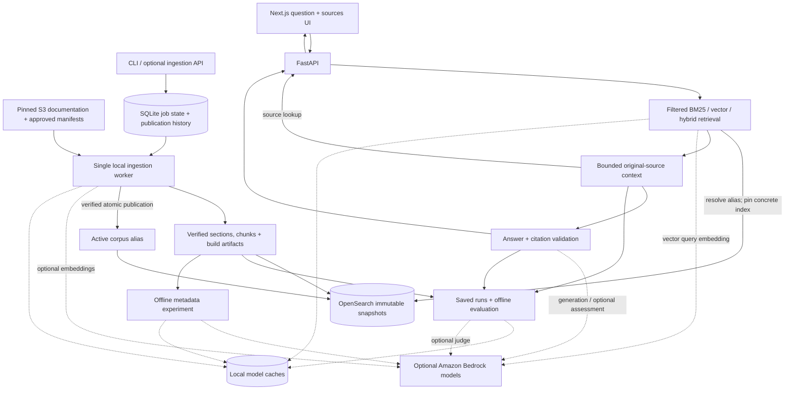

# Aether — AWS S3 Knowledge Engine

Ask questions about Amazon S3 documentation and inspect the original passages behind an answer. Aether combines a Next.js question-and-sources interface, a Python API, and OpenSearch retrieval over a curated, reproducible documentation snapshot.

**Source search runs locally without AWS credentials or model calls.** Generated answers, vector search, and model-based evaluation are optional Bedrock integrations. The project is under active development; independently reviewed quality benchmarks and an AWS deployment are still pending.

## What works today

- **Inspect sources:** keyword search with guide and corpus filters, original passage text, and links to pinned source material and current publisher documentation.
- **Ask with citations:** Bedrock-generated answers, streaming responses, and citation links back to the selected passages. Missing model configuration is reported while preserving retrieved sources.
- **Choose retrieval:** BM25, vector search, or hybrid retrieval with reciprocal rank fusion. Vector and hybrid modes require an embedding-enabled corpus and Bedrock configuration.
- **Try a bounded workflow:** an optional LangGraph flow assesses evidence, can refine retrieval once, and answers or returns insufficient evidence. It has explicit call, retrieval, and time limits.
- **Publish safely:** durable local ingestion jobs, idempotency keys, cancellation, recovery, immutable index snapshots, atomic alias publication, and rollback to retained snapshots.
- **Evaluate reproducibly:** saved rankings and exact answer context, source-span labels, candidate pooling for review, and optional Ragas judging of saved answers.
- **Prepare metadata experiments:** bounded, cached generation of summaries and topic/intent hints as separate unreviewed artifacts, with original-content fallback on failure.

“S3” describes the documentation domain. The current implementation downloads pinned public text files and stores artifacts locally; it does not inspect your AWS account or ingest arbitrary S3 buckets.

## Architecture



Source hashes and character offsets preserve provenance through extraction and chunking. Each publication builds and verifies a new index before switching the active alias; readers use a concrete snapshot for a consistent request. SQLite and filesystem artifacts support a single-host worker. This is a local development architecture, with OpenSearch authentication disabled and service ports bound to loopback.

## Quickstart: Docker application

Requires Docker with Compose **2.24.4 or later**. Run commands from the repository root. The stack includes OpenSearch, the API, an ingestion worker, and the production frontend; no local Python or Node installation is needed for this path.

```sh
git clone https://github.com/anushacodes/Aether.git
cd Aether

docker compose -f compose.app.yaml build api frontend
docker compose -f compose.app.yaml up -d --no-build --wait --wait-timeout 180

# Download and hash-check the pinned public documentation.
docker compose -f compose.app.yaml exec api s3-rag --config config.toml corpus fetch

# First publication into a fresh stack. The running worker picks up this job.
docker compose -f compose.app.yaml exec api s3-rag --config config.toml jobs submit \
  --key docker-pilot-v1 --base-revision none
```

The submit command prints a `job_id`. Replace `JOB_ID` below with that value and check for `status: ready`:

```sh
docker compose -f compose.app.yaml exec api s3-rag --config config.toml jobs status JOB_ID
docker compose -f compose.app.yaml logs --tail=50 worker
curl --fail http://localhost:18000/health/ready
```

Readiness returns a non-success response until the corpus is published. Open **http://localhost:13000**, enter a question such as “What happens when I delete an object in a versioned bucket?”, and select **Find sources**. The default pilot contains three passages about versioning and deletion. **Ask question** requires the optional model configuration described below.

| Service | Docker application | Native development |
| --- | --- | --- |
| Frontend | http://localhost:13000 | http://localhost:3000 |
| API / interactive API docs | http://localhost:18000/docs | http://localhost:8000/docs |
| OpenSearch | http://localhost:19200 | http://localhost:9200 |

To stop the application while preserving its named data volumes:

```sh
docker compose -f compose.app.yaml down
```

`--base-revision none` is only for the first publication. For later changes, use `jobs catalog` to obtain the current `active_revision`, pass it as `--base-revision`, and choose a new idempotency key. Reusing a key for the same request returns the original job; changing its intent is rejected.

## Native development

Requires Python **3.12**, [uv](https://docs.astral.sh/uv/), Node.js **22.18 or later**, npm, and Docker for OpenSearch. Dependencies are pinned in `uv.lock` and `frontend/package-lock.json`.

```sh
uv sync --locked
npm --prefix frontend ci
make search-up

uv run --locked s3-rag --config config.toml corpus fetch
uv run --locked s3-rag --config config.toml jobs submit \
  --key local-pilot-v1 --base-revision none
uv run --locked s3-rag --config config.toml worker --once

uv run --locked s3-rag --config config.toml search query \
  "What happens when I delete a versioned object?" --mode bm25
```

Start the API and frontend in separate terminals:

```sh
make api
```

```sh
npm --prefix frontend run dev
```

Use `make worker` when you want a continuously running native ingestion worker. Run only one worker for a given state database. The Docker application and native development stack use separate ports and volumes; their corpora are independent.

## Configuration and optional Bedrock calls

[config.toml](config.toml) defines the pilot. [config.core.toml](config.core.toml) selects a separate core corpus, alias, and publication state. CLI commands load TOML when passed `--config`; the API loads root `config.toml` automatically. Exported `RAG_*` environment variables override the corresponding settings.

[.env.example](.env.example) documents supported overrides. The backend does **not** automatically load an `.env` file. Use TOML or export selected variables in the shell that launches the process.

| Setting | Purpose |
| --- | --- |
| `RAG_OPENSEARCH_URL` | Search service URL |
| `RAG_AWS_REGION`, `RAG_AWS_PROFILE` | Bedrock region and optional credential profile |
| `RAG_GENERATION_MODEL_ID` | Explicitly selected Bedrock answer model |
| `RAG_DEVELOPMENT_MODEL_BUDGET_USD` | Required explicit allowance before paid calls; not an AWS billing cap |
| `RAG_EMBEDDING_MODEL_ID`, `RAG_EMBEDDING_DIMENSIONS` | Compatible embedding model and index dimensions; defaults are Titan V2 and 1024 |
| `RAG_EVALUATOR_MODEL_ID` | Separate optional Bedrock judge model |
| `RAG_ENRICHMENT_MODEL_ID` | Separate optional model for offline metadata experiments |
| `RAG_ALLOWED_ORIGINS` | JSON array of allowed browser origins |
| `RAG_ADMIN_TOKEN` | Server-only bearer token; unset disables ingestion HTTP endpoints |

For generated answers, configure AWS credentials through the normal AWS credential chain, choose an accessible generation model, and set a development allowance. The supplied pilot TOML uses `us-east-1`. Validate configuration without contacting AWS:

```sh
uv run --locked s3-rag --config config.toml config --cloud
```

After supplying those settings, `ask` generates an answer from BM25 evidence; `--workflow` enables the optional evidence-assessment flow, and `--save-run NEW_DIRECTORY` captures the request, result, and exact context for evaluation. Ingestion with `--with-embeddings` builds vector coverage; vector and hybrid queries can then embed the question through Bedrock. These operations can incur provider charges. Text-only ingestion and BM25 source lookup do not call a model.

The default application Compose file intentionally passes no AWS credentials or model settings into its services. Use native development for model experiments, or explicitly extend the service configuration. Never place credentials or `RAG_ADMIN_TOKEN` in a `NEXT_PUBLIC_*` variable.

The frontend uses `NEXT_PUBLIC_RAG_API_URL` from [frontend/.env.example](frontend/.env.example). For native development, an optional `frontend/.env.local` can override the default `http://localhost:8000`. The container frontend embeds its browser API URL at **build time**: changing `RAG_API_PORT` or `RAG_BROWSER_API_URL` requires rebuilding the frontend. Use a URL reachable by the browser.

## Corpus and source provenance

The [source manifest](data/manifests/sources.json) pins two public text files—the S3 User Guide and API Reference—to revision `af421087e43e33d41051a80356e285fa4c199b8a` of [the source snapshot repository](https://github.com/PranavMishra17/Metadata-Enrichment-with-LLMs-for-RAGs-Internal-Knowledge-Retrieval/tree/af421087e43e33d41051a80356e285fa4c199b8a/input_files). Downloads are verified against recorded SHA-256 hashes. These are historical snapshots, rather than a live mirror of AWS documentation.

| Corpus | Manifest | Default chunking | Publication alias |
| --- | --- | --- | --- |
| Pilot: 3 selected sections about versioning and deletion | [pilot.json](data/manifests/pilot.json) | Fixed chunks | `s3-rag-active` |
| Core: 40 selected sections covering common S3 operations | [core.json](data/manifests/core.json) | Heading-aware chunks | `s3-rag-core` |

The core selections cover topics including uploads and multipart uploads, downloads and ranges, checksums, access controls, versioning, deletion, and lifecycle. They do not constitute the complete S3 documentation or current guidance for every S3 feature.

To publish the core corpus into the native OpenSearch stack for the first time:

```sh
uv run --locked s3-rag --config config.core.toml corpus fetch
uv run --locked s3-rag --config config.core.toml jobs submit \
  --catalog-id core --key core-initial-v1 --base-revision none
uv run --locked s3-rag --config config.core.toml worker --once
uv run --locked s3-rag --config config.core.toml search query \
  "How does multipart upload work?" --corpus-id s3-core-v1 --mode bm25
```

This leaves the pilot configuration intact. Use the coherent core configuration for both publication and reads: changing `RAG_SEARCH_INDEX` alone does not change the publication alias or job database. The default API and frontend remain on the pilot.

## API and operations

Example source lookup against the Docker application:

```sh
curl --fail http://localhost:18000/retrieval \
  -H 'Content-Type: application/json' \
  -d '{"query":"What happens when I delete a versioned object?","mode":"bm25"}'
```

| Route | Behavior |
| --- | --- |
| `GET /health/live` | Process liveness |
| `GET /health/ready` | Search service and configured corpus readiness |
| `POST /retrieval` | Source passages without answer generation |
| `POST /search` | Answer with citations |
| `POST /search/stream` | Answer stream using server-sent events over POST |
| `/ingestion`, `/ingestion/catalog`, `/ingestion/{job_id}` | Token-protected job submission and inspection; cancel/replay routes are also available |

The `/docs` page describes request and response schemas. Requests can restrict guides and corpus identity; generated answers use bounded original passages. Citation validation checks that cited identifiers belong to the supplied evidence. It does not prove that every claim is supported.

Use `s3-rag --help` and command-specific `--help` for the CLI surface. Useful operations include `jobs catalog`, `jobs status`, `jobs cancel`, `jobs replay`, and `index snapshots`. Rollback requires a retained snapshot ID and the expected current concrete index as `--base-revision`; stale publication requests are rejected. Retained snapshots are local recovery material, not an independent backup.

## Evaluation

Quality labels are kept separate from ingestion evidence. The checked-in [pilot](data/eval/pilot.json) and [core development](data/eval/core-development.json) datasets are **drafts**. They need independent review before their scores can support quality claims; there is no reviewed held-out benchmark yet.

Inspect draft labels without invoking a model:

```sh
uv run --locked s3-rag eval validate \
  --dataset data/eval/core-development.json --allow-drafts
```

The evaluation workflow supports:

1. **Retrieval capture:** `eval retrieval` records rankings, the selected context, configuration identity, and a pinned index. Supply the matching extracted sections and chunks. `--allow-drafts` permits development inspection without certifying label quality.
2. **Evidence review:** `eval pool` combines candidates from compatible saved runs for human review. Repeated retrieval is not treated as a relevance vote.
3. **Saved-answer preparation:** `eval prepare-answers` validates saved answer artifacts against dataset questions and original evidence without model calls.
4. **Optional judging:** `eval judge` runs Ragas faithfulness, context precision with reference, context recall, and factual correctness against reviewed samples using an explicitly configured Bedrock judge.

Install the optional evaluation dependencies and exercise the judge contracts without provider calls:

```sh
uv sync --locked --group eval
make ragas-check
```

The judge runs serially with sample, call, output, and time limits plus a persistent cache. Results preserve errors, undefined scores, and inapplicable cases. The offline check uses synthetic fixtures and SDK stubs; passing it establishes integration behavior, not S3 answer quality. Real provider quality, latency, and cost measurements remain pending.

## Metadata experiments

The optional `enrich` command prepares short summaries, constrained topic/intent labels, related concepts, and example phrasings from explicit source chunks. It requires its own model selection, region, and development allowance. It can incur Bedrock charges and is never invoked by ordinary search or ingestion.

After configuring those settings, prepare the pilot chunks and a new experiment directory:

```sh
uv run --locked s3-rag --config config.toml corpus chunk
uv run --locked s3-rag --config config.toml enrich \
  --output reports/runs/pilot-metadata-v1
```

The default limit is ten chunks and twenty calls, including at most one repair per malformed response. Larger inputs are rejected rather than silently truncated; use repeated `--chunk-id` arguments to select an explicit subset. Valid metadata is cached by exact input, model, schema, and prompt settings. Failures preserve the complete original passage and return a nonzero CLI exit status.

Artifacts include unchanged source records, per-chunk outcomes, proposed embedding inputs, hashes, and known token usage. Everything is marked unreviewed. Generated hints need factual auditing before comparison: these artifacts do not publish an enriched index or change answer evidence. Metadata-backed retrieval, live output auditing, and measured quality comparisons remain pending.

## Development checks

```sh
make check                       # Python lint, formatting, and focused tests
npm --prefix frontend test       # Browser transport contracts
npm --prefix frontend run build  # Production frontend build
```

With native OpenSearch running and pinned sources fetched:

```sh
make search-check
make ingestion-check workflow-check snapshot-check
```

The integration checks use isolated local test indexes and stub model responses. With the Docker application seeded, `python3 tests/check_local_app.py` checks the running frontend, API, source lookup, CORS, and unconfigured-model streaming behavior. These checks make no paid model calls.

[GitHub Actions](https://github.com/anushacodes/Aether/actions/workflows/checks.yml) runs backend, frontend, local integration, application-image, and offline evaluation checks.

## Repository layout

```text
rag/                    Python corpus, retrieval, generation, jobs, API, and evaluation
frontend/               Next.js question-and-sources application
data/manifests/         Tracked source hashes and approved corpus selections
data/eval/              Tracked draft evaluation datasets
tests/                  Focused tests and local integration checks
config.toml             Pilot configuration
config.core.toml        Isolated core configuration
compose.yaml            Native-development OpenSearch service
compose.app.yaml        Full local application stack
```

Raw downloads, processed data, caches, snapshots, databases, and run reports are generated locally and ignored by Git. Detailed plans and architecture decisions live in the local, Git-ignored `docs/` directory; they are not distributed with a fresh clone.

## Remaining work

- Independently review evaluation labels, establish a held-out set, and measure real Bedrock answer quality, latency, and cost.
- Audit metadata experiments and compare retrieval and optional workflow variants before claiming improvements; metadata-backed retrieval and reranking remain pending.
- Prepare AWS infrastructure and deployment, remote artifact persistence, authentication for hosted access, independent backups, and operational retention policies.

The current local stack has no production deployment, multi-host ingestion queue, or automatic snapshot pruning.
